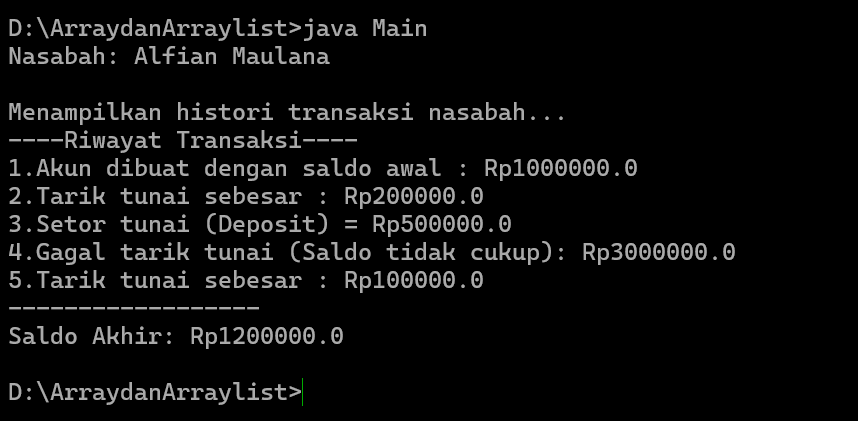

# Array dan ArrayList — Sistem Perbankan Sederhana (Java)

Program Java berbasis OOP yang mensimulasikan sistem perbankan sederhana. Proyek ini mendemonstrasikan penggunaan **Array** (untuk menyimpan daftar nasabah dan akun) serta **ArrayList** (untuk menyimpan riwayat transaksi).

Repository: [https://github.com/ZoeArc/Array-dan-ArrayList](https://github.com/ZoeArc/Array-dan-ArrayList)

---

## 📁 Struktur File

```
.
├── Account.java    # Saldo, deposit, withdraw, dan riwayat transaksi (ArrayList)
├── Bank.java       # Menyimpan maksimal 5 nasabah (Array)
├── Customer.java   # Data nasabah dan maksimal 5 akun (Array)
├── Main.java       # Program utama (simulasi transaksi)
├── screenshots/
│   └── output.png  # Screenshot hasil program
└── README.md
```

## 🧩 Deskripsi Kelas

| Kelas      | Penjelasan |
| ---------- | ---------- |
| `Account`  | Menyimpan saldo dan riwayat transaksi (`ArrayList<String>`). Memiliki method `getBalance()`, `deposit()`, `withdraw()`, dan `printHistory()`. |
| `Customer` | Menyimpan nama depan, nama belakang, dan array `Account[5]`. Memiliki method `setAccount()` dan `getAccount()`. |
| `Bank`     | Menyimpan array `Customer[5]`. Memiliki method `addCustomers()`, `getCustomer()`, dan `getNumberOfCustomers()`. |
| `Main`     | Kelas utama yang membuat nasabah, akun, lalu menjalankan transaksi tarik tunai dan setor tunai. |

---

## 📦 Library Tambahan

**Tidak ada library eksternal** yang perlu diinstal. Program hanya menggunakan library bawaan Java (Java Standard Library):

| Library                | Digunakan di   | Fungsi |
| ---------------------- | -------------- | ------ |
| `java.util.ArrayList`  | `Account.java` | Menyimpan riwayat transaksi secara dinamis |

---

## ⚙️ Cara Menjalankan

**Prasyarat:** JDK (Java Development Kit) 8 atau lebih baru.

1. Clone repository:
   ```bash
   git clone https://github.com/ZoeArc/Array-dan-ArrayList.git
   cd Array-dan-ArrayList
   ```
2. Compile semua file:
   ```bash
   javac *.java
   ```
3. Jalankan program:
   ```bash
   java Main
   ```

---

## 🖼️ Screenshot

### Hasil Output Program



### Skenario Transaksi pada `Main.java`

| No | Transaksi                  | Hasil |
| -- | -------------------------- | ----- |
| 1  | Tarik tunai Rp200.000      | Berhasil |
| 2  | Setor tunai Rp500.000      | Berhasil |
| 3  | Tarik tunai Rp3.000.000    | Gagal (saldo tidak cukup) |
| 4  | Tarik tunai Rp100.000      | Berhasil |

---

## 📝 Catatan

- Kapasitas `Bank` maksimal **5 nasabah**, dan `Customer` maksimal **5 akun**.
- Setiap transaksi (berhasil maupun gagal) dicatat pada riwayat transaksi.
- Setor tunai hanya diterima jika nominal lebih besar dari 0.

---

## 👤 Identitas

| Keterangan     | Isian |
| -------------- | ----- |
| Nama           |    Muhamad Alfian Maulana   |
| NIM            |    F1D02510077   |
| Kelas          |   3B    |
| Mata Kuliah    |     Pemrograman Berorientasi Objek  |
